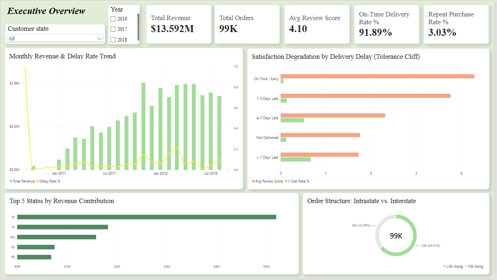
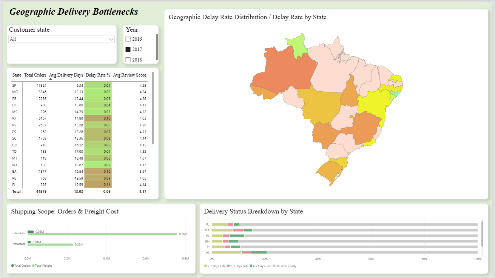
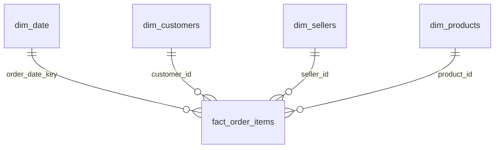
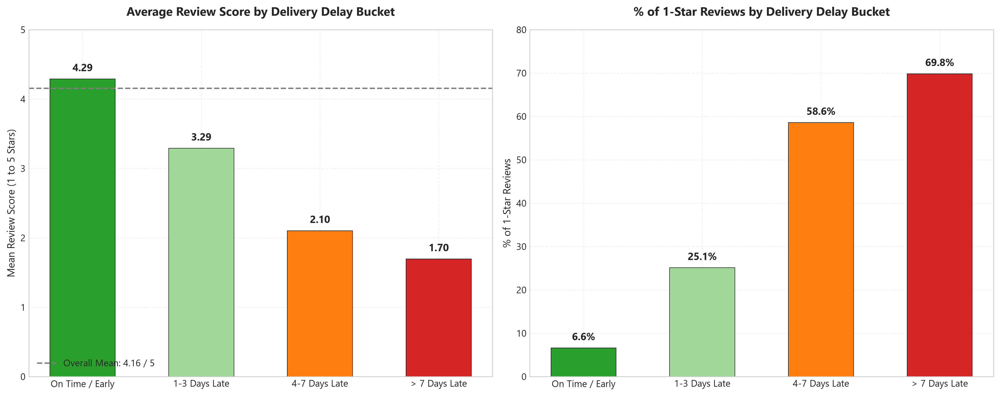
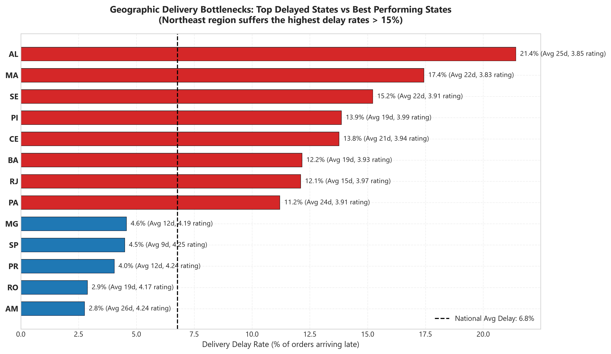
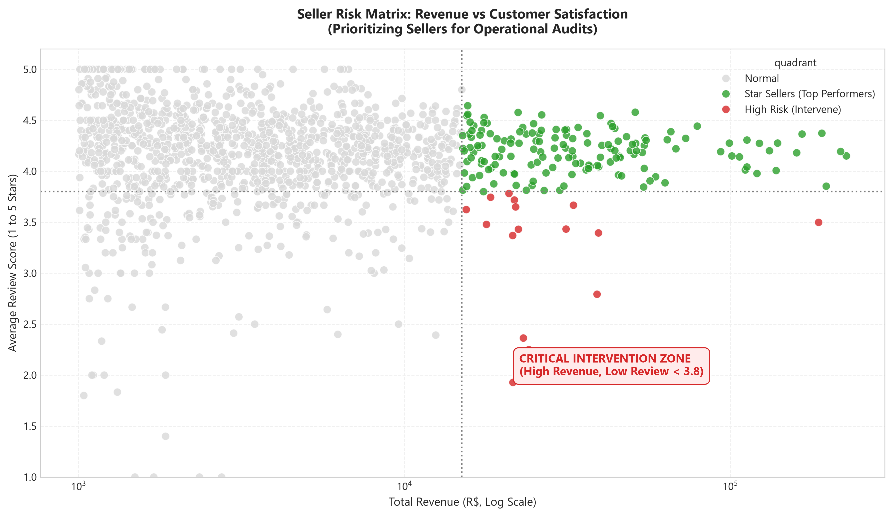
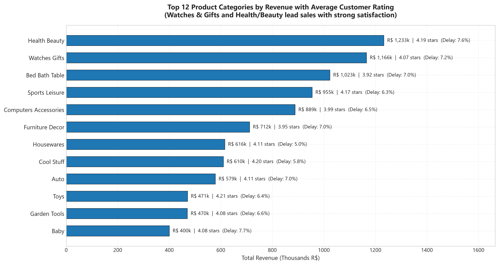
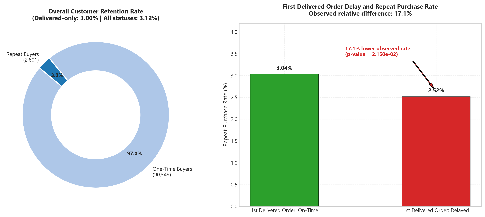

# Olist Brazilian E-Commerce: Phân Tích Hiệu Suất Vận Chuyển & Mức Độ Hài Lòng Khách Hàng


Dự án phân tích dữ liệu toàn diện (End-to-End Data Analytics Project) khai thác hành trình của gần **100.000 đơn hàng thực tế** (99,441 đơn hàng, 112,650 dòng sản phẩm) trên nền tảng thương mại điện tử Olist (Brazil). Dự án tập trung giải quyết bài toán: **Ảnh hưởng của sự chậm trễ vận chuyển (logistics delay) đối với mức độ hài lòng khách hàng (review score), tỷ lệ giữ chân khách hàng (retention rate), và nhận diện các rủi ro vận hành trong mạng lưới đối tác bán hàng (sellers).**

---

## 📌 1. Bối Cảnh Nghiệp Vụ & Bài Toán Kinh Doanh

Olist là sàn thương mại điện tử kết nối các doanh nghiệp vừa và nhỏ (SMBs) trên khắp Brazil. Trong mô hình này, Olist không sở hữu kho hàng hay đội xe vận chuyển mà phụ thuộc vào đối tác bán hàng và bưu chính quốc gia (Correios). 

**Vấn đề cốt lõi:**
* Địa lý Brazil rộng lớn với hạ tầng giao thông phân hóa mạnh giữa miền Nam/Đông Nam giàu có và miền Đông Bắc (Northeast) xa xôi.
* Trải nghiệm giao hàng không đồng đều dẫn đến làn sóng đánh giá 1 sao, gia tăng chi phí hỗ trợ khách hàng và làm suy giảm tỷ lệ khách hàng quay lại mua sắm.

---

## 💡 2. 5 Phát Hiện Kinh Doanh Trọng Yếu (Executive Insights)

Dựa trên việc làm sạch và phân tích **96,470 đơn hàng đã giao thành công hợp lệ** (loại bỏ các đơn thiếu ngày giao thực tế hoặc ngày dự kiến) và **93,350 khách hàng duy nhất có đơn giao thành công** giai đoạn 2016 – 2018:

1. **Mối liên hệ giữa độ trễ giao hàng và điểm đánh giá:** Điểm đánh giá trung bình giảm từ **4.29 ★** ở nhóm giao đúng hạn/sớm xuống **3.29 ★** ở nhóm trễ 1–3 ngày và tiếp tục giảm xuống **2.10 ★** ở nhóm trễ 4–7 ngày (với **58.58%** đánh giá 1 sao). Kết quả cho thấy trải nghiệm khách hàng kém hơn ở các nhóm giao trễ dài hơn trong tập dữ liệu phân tích, song chưa đủ để kết luận độ trễ là nguyên nhân duy nhất quyết định điểm đánh giá.
2. **Điểm nghẽn Logistics theo khu vực (Khu vực Đông Bắc):**
   * Các bang thuộc vùng Đông Bắc chịu tỷ lệ giao trễ cao: Alagoas (`AL`: **21.41%**), Maranhão (`MA`: **17.43%**), Sergipe (`SE`: **15.22%**), cao gấp 3.1–4.8 lần so với bang trung tâm kinh tế São Paulo (`SP`: **4.49%**).
   * Đơn hàng vận chuyển liên bang (Interstate) mất trung bình **15.1 ngày**, gần gấp đôi so với nội bang (**7.9 ngày**) và có tổng chi phí cước vận chuyển trung bình mỗi đơn cao hơn **75.5%** (26.94 R$ so với 15.35 R$).
3. **16 Seller ứng viên rủi ro (Candidate Sellers) theo chuẩn Order-Deduplicated:** Gồm **11 seller đủ cỡ mẫu** (≥ 30 đơn, ưu tiên rà soát quy trình vận hành) và **5 seller ít đơn** (cần theo dõi riêng do cỡ mẫu nhỏ). Các nhà bán hàng này tạo ra doanh thu trên 15,000 R$ từ các đơn giao thành công hợp lệ nhưng điểm đánh giá trung bình dưới 3.8 ★. Đây là quy tắc sàng lọc nội bộ của dự án, không phải kết luận mọi seller trong nhóm đều đã được xác nhận là nguyên nhân gây ra vấn đề vận hành.
   * *Lưu ý phương pháp:* Tỷ lệ trễ của nhóm 11 seller (9.00%) được tính bằng tổng số đơn trễ chia tổng số đơn của nhóm. Thời gian dispatch trung bình (7.04 ngày) là trung bình ở cấp đơn hàng, với mỗi đơn hàng có trọng số bằng nhau, tránh sai lệch do cỡ mẫu không đồng đều.
4. **Tỷ lệ khách hàng mua lại hoàn tất (Repeat Completed Purchases): 3.00%:**
   * Trong 93,350 khách hàng có đơn giao thành công hợp lệ, có **2,801 khách hàng** từng hoàn tất giao dịch lần thứ 2 trở lên (**3.00%**). 
5. **Tỷ lệ mua lại khác biệt theo trạng thái đơn đầu tiên giao thành công (First Delivered Order Status & Repeat Purchase):**
   * Tỷ lệ mua lại ở nhóm khách hàng có đơn đầu tiên giao đúng hạn là **3.04%**, trong khi nhóm có đơn đầu tiên bị trễ đạt **2.52%** (mức chênh lệch tương đối khoảng **17.1%**, kiểm định Chi-Square $\chi^2 \approx 5.29, p = 0.0215$). Kết quả phản ánh sự khác biệt có ý nghĩa thống kê trong tập dữ liệu quan sát; đây là **mối liên hệ quan sát được**, không phải bằng chứng khẳng định giao trễ là **nguyên nhân duy nhất** làm giảm tỷ lệ mua lại. Đề xuất thử nghiệm cơ chế theo dõi ưu tiên cho nhóm này và đối chiếu với nhóm chứng trước khi triển khai rộng rãi.
6. **Xu hướng Thời gian & Mùa vụ (Khai thác `dim_date` 2017–2018):**
   * Doanh thu mở rộng từ **111.8k R$** (tháng 1/2017) lên đỉnh **987.6k R$** vào Black Friday (tháng 11/2017). 
   * Áp lực logistics vào các đợt cao điểm mùa vụ làm tăng vọt tỷ lệ trễ (tháng 11/2017: **11.91%**, tháng 3/2018: **18.05%**), kéo điểm đánh giá rớt mạnh xuống **3.75 ★ – 3.90 ★**. Khi tỷ lệ trễ hạ nhiệt về **1.16%** (tháng 6/2018), điểm đánh giá lập tức hồi phục lên **4.21 ★ – 4.27 ★**.
7. **Mô phỏng Ước lượng Tác động Vận hành (Scenario Modeling):**
   * **Tối ưu logistics tại Alagoas (AL):** Nếu giảm tỷ lệ trễ từ 21.41% về mức mục tiêu 10.00% (chuyển ~45 đơn trễ sang đúng hạn), điểm review trung bình của bang dự kiến tăng từ **3.85 ★ lên 4.08 ★** (+0.23 ★, vượt ngưỡng 4 sao).
   * **Kiểm soát SLA 48h cho 11 Seller rủi ro:** Đưa tỷ lệ trễ của nhóm từ 9.00% về chuẩn sàn (4.5%) giúp cứu vãn ~144 đơn hàng và bảo vệ hơn **22,000 R$** doanh thu khỏi nguy cơ khiếu nại.
   * **Bảo vệ đơn đầu tiên:** Giảm tỷ lệ trễ đơn đầu từ 6.77% xuống 3.50% giúp giữ chân thêm ước tính **~16 khách hàng trung thành** quay lại mua lần 2 mà không tốn chi phí CAC.

> 📌 **Tính Liêm Chính Phương Pháp Luận (Methodological Notes):**
> - **Chuẩn hóa ngày lịch cho chỉ số giao trễ (Calendar Day Normalization):** Trong dataset gốc, `order_estimated_delivery_date` luôn mang mốc giờ mặc định `00:00:00`, trong khi `order_delivered_customer_date` có đầy đủ giờ/phút/giây. Nếu trừ trực tiếp dấu thời gian (timestamp subtraction), các đơn giao vào buổi chiều của đúng ngày hẹn sẽ bị tính nhầm là trễ một phần ngày (> 0). Do đó, pipeline thực hiện chuẩn hóa lịch ngày (`dt.normalize()`) trước khi tính `delivery_delay_days = (delivered_date - estimated_date).dt.days`. Bất kỳ đơn nào giao trong ngày dự kiến đều được tính là đúng hạn (`delay <= 0`), phản ánh đúng thực tế cam kết logistics của sàn.
> - **Phân định rõ hai khái niệm khách hàng (96,096 vs 93,350):** 
>   - **96,096 khách hàng duy nhất:** Tính trên toàn bộ 99,441 đơn hàng phát sinh (mọi trạng thái). Tỷ lệ khách hàng từng đặt từ lần 2 trở lên trên toàn sàn là **3.12%** (2,997 / 96,096).
>   - **93,350 khách hàng duy nhất có đơn giao thành công:** Tính trên tập 96,470 đơn delivered hợp lệ. Mẫu số chuẩn được dùng trên Power BI Dashboard, Star Schema và Báo cáo để tính **Tỷ lệ Mua lại Hoàn tất: 3.00%** (2,801 / 93,350 khách hàng).
> - **Giới hạn quan sát (Right-Censoring):** Khách hàng có đơn đầu tiên vào cuối giai đoạn dữ liệu có ít thời gian hơn để phát sinh đơn mua lại. Tỷ lệ mua lại 3.00% được tính trên toàn bộ dữ liệu tĩnh, không tương đương với tỷ lệ retention trong một cửa sổ cố định (như 60 ngày).
> - **Tương quan (Correlation) vs Nhân quả (Causation):** Dữ liệu quan sát cho thấy mối liên hệ giữa thời gian giao trễ, điểm đánh giá và tỷ lệ mua lại, nhưng chưa thể kết luận quan hệ nhân quả duy nhất. Các đề xuất vận hành được định vị là **Giả thuyết kinh doanh cần kiểm chứng qua thử nghiệm có nhóm đối chứng (A/B Testing)**.
> - 🔒 **Kiểm chứng tính toàn vẹn dữ liệu (Data Grain Integrity):** Đã thực hiện kiểm tra tính nhất quán của `review_score` và `is_delayed` tại cấp độ `order_id` trên tập đơn hàng giao thành công hợp lệ. Truy vấn kiểm tra `COUNT(DISTINCT ...)` không trả về đơn hàng có nhiều giá trị khác nhau. Kết quả hỗ trợ giả định rằng mỗi đơn hàng có một giá trị review và trạng thái giao trễ nhất quán, giảm nguy cơ đếm trùng khi tổng hợp. Các kết quả định lượng (Q3: 3,201 đơn, trễ 9.00%, dispatch 7.04 ngày; Q5: $\chi^2 \approx 5.29, p = 0.0215$) đã được xác minh khớp với dữ liệu đầu ra và kiểm thử tự động tại `src/test_data_integrity.py`.

---

## 🖥️ 3. Báo Cáo Trực Quan Tương Tác Power BI (3-Page Dashboard)

Mô hình Dashboard được thiết kế theo tiêu chuẩn Business Intelligence doanh nghiệp, gồm 3 trang phân tích chuyên biệt:

### 📄 Trang 1: Executive Overview (Tổng Quan Điều Hành)
> **Mục tiêu:** Theo dõi các chỉ số sức khỏe tài chính và vận hành cốt lõi, phát hiện xu hướng giao trễ và tác động trực tiếp của sự trễ hạn tới mức độ hài lòng khách hàng.



* **Hàng KPI Cards:**
  * **Tổng doanh thu giao dịch (Gross Order Value):** R$ 15.42M / **Delivered Product Revenue:** R$ 13.22M.
  * **Tổng đơn hàng:** 96.5K (96,470 đơn giao thành công hợp lệ).
  * **Tỷ lệ giao đúng hạn (On-Time Delivery Rate):** 93.2% (tương ứng 6.77% trễ ở cấp Order-level).
  * **Điểm đánh giá trung bình:** 4.16 ★ (trên đơn delivered hợp lệ).
  * **Tỷ lệ khách hàng quay lại:** 3.00% (2,801 / 93,350 khách hàng có đơn delivered).

> 💡 **Ghi chú về Chuẩn Mẫu số & Grain Mismatch:** Tỷ lệ giao đúng hạn toàn quốc đạt **93.23%** trên **96,470 đơn hàng giao thành công có đầy đủ ngày giao thực tế và ngày dự kiến**. Pipeline sử dụng cờ `is_valid_delivery_delay` để loại bỏ các đơn thiếu dữ liệu, tránh tính nhầm thành giao đúng hạn.

---

### 📄 Trang 2: Geographic Delivery Bottlenecks (Điểm Nghẽn Vận Chuyển Theo Địa Lý)
> **Mục tiêu:** Bóc tách hiệu suất giao hàng theo từng bang của Brazil, phân tích tuyến giao hàng liên bang vs nội bang.



* **Bản đồ trực quan (Brazil Choropleth Map):** Trực quan hóa tỷ lệ giao trễ theo các bang, làm nổi bật điểm nóng tại dải bang Đông Bắc (AL 21.4%, MA 17.4%, SE 15.2%). 
* **So sánh Vận chuyển (Intrastate vs Interstate):** Đo lường sự chênh lệch rõ rệt về thời gian vận chuyển thực tế (7.9 ngày vs 15.1 ngày) và gánh nặng chi phí cước ship (15.35 R$ vs 26.94 R$).

---

### 📄 Trang 3: Seller Performance & Category Matrix (Hiệu Suất Đối Tác & Ngành Hàng)
> **Mục tiêu:** Phân loại đối tác người bán, giám sát ma trận rủi ro và xác định danh sách các đối tác ứng viên cần rà soát quy trình vận hành.


* **Ma trận Rủi ro Người bán (Seller Risk Scatter Plot):** Trục X = Doanh thu người bán (R$), Trục Y = Điểm đánh giá trung bình. Phân loại nhóm *Star Sellers* và nhóm *Candidate Sellers / Audit Required* (Góc dưới bên phải: Doanh thu cao, Đánh giá kém < 3.8 ★, dùng làm tiêu chí sàng lọc rà soát).
* **Top Ngành hàng hàng đầu:** Dẫn đầu doanh thu: `Health Beauty` (R$ 1.23M), `Watches Gifts` (R$ 1.17M), `Bed Bath Table` (R$ 1.02M).
* **Bảng Hành động Đối tác (Seller Action Table):** Liệt kê chi tiết mã Seller, thành phố, doanh thu, thời gian chuẩn bị hàng, tỷ lệ trễ và trạng thái rủi ro.

---

## 🏛️ 4. Kiến Trúc Mô Hình Dữ Liệu Star Schema (Kimball Methodology)

Toàn bộ dữ liệu sau khi làm sạch đã được chuyển đổi thành mô hình **Kimball Star Schema** chuẩn mực:



* **Bảng Fact:** `fact_order_items` (112,650 dòng, Grain = 1 sản phẩm trong 1 đơn hàng).
* **Các bảng Dimension:** `dim_customers` (99,441 dòng), `dim_sellers` (3,095 dòng), `dim_products` (32,951 dòng), `dim_date` (1,096 dòng).
* **Kỹ thuật xử lý Grain Mismatch trong DAX:** Do `review_score` là dữ liệu ở cấp độ đơn hàng (`order-level`), nhưng bảng Fact lại có độ chi tiết là cấp độ sản phẩm (`item-level`), toàn bộ các measure tính trung bình đều sử dụng công thức Grain-Safe:
  ```dax
  Avg Review Score Delivered = 
  AVERAGEX(
      FILTER(
          SUMMARIZE(
              fact_order_items, 
              fact_order_items[order_id], 
              fact_order_items[order_status],
              fact_order_items[is_valid_delivery_delay],
              fact_order_items[review_score]
          ),
          fact_order_items[order_status] = "delivered" && 
          fact_order_items[is_valid_delivery_delay] = 1 &&
          NOT(ISBLANK(fact_order_items[review_score]))
      ),
      fact_order_items[review_score]
  )
  ```

---

## 📈 5. Biểu Đồ Phân Tích Thống Kê Chuyên Sâu (Python Visualizations)

Bộ biểu đồ khoa học được sinh tự động bằng Seaborn/Matplotlib với độ phân giải xuất bản **300 DPI**:

| Hình 1: Mối Liên Hệ Giữa Độ Trễ Giao Hàng & Điểm Đánh Giá | Hình 2: Hiệu Suất Vận Chuyển Theo Bang |
| :---: | :---: |
|  |  |
| *Điểm đánh giá trung bình có xu hướng giảm ở các nhóm trễ, đặc biệt thấp từ ngày trễ thứ 4 trở đi* | *Tỷ lệ giao hàng trễ ghi nhận mức cao tại một số bang Đông Bắc* |

| Hình 3: Ma Trận Phân Loại Rủi Ro Seller | Hình 4: Hiệu Suất Danh Mục Sản Phẩm |
| :---: | :---: |
|  |  |
| *Xác định nhóm người bán doanh thu cao nhưng điểm đánh giá kém* | *Xếp hạng doanh thu và tỷ trọng cước phí vận chuyển theo ngành hàng* |

| Hình 5: Tỷ Lệ Khách Hàng Mua Lại Theo Trạng Thái Đơn Đầu Tiên |
| :---: |
|  |
| *Chênh lệch tỷ lệ mua lại giữa nhóm đơn đầu đúng hạn (3.04%) và giao trễ (2.52%), chênh lệch tương đối ~17.1% (mối liên hệ quan sát được, p = 0.0215)* |

---

## 📁 6. Cấu Trúc Thư Mục Dự Án (Repository Structure)

```text
olist-ecommerce-data-analyst/
├── data/
│   ├── raw/                 # 9 bộ dữ liệu CSV gốc tải từ Kaggle (được .gitignore)
│   ├── processed/           # Dữ liệu sạch & Master Analytical Dataset (112k dòng)
│   │   └── star_schema/     # 5 file CSV cấu trúc Star Schema (Fact & Dims)
│   └── olist_star_schema.db # Cơ sở dữ liệu SQLite đã đánh 7 B-Tree Indexes
├── docs/
│   ├── 01_data_dictionary.md          # Từ điển dữ liệu & kiểu dữ liệu chi tiết
│   ├── 02_data_relationships.md       # Ma trận khóa chính - khóa ngoại (PK-FK integrity)
│   ├── 03_business_problem.md         # Bối cảnh kinh doanh, phạm vi & mục tiêu phân tích
│   ├── 04_data_quality_report.md      # Biên bản kiểm toán chất lượng dữ liệu
│   ├── 05_data_cleaning_log.md        # Nhật ký xử lý dữ liệu & feature engineering
│   ├── 06_business_insights_report.md # Báo cáo chi tiết đề xuất giải pháp kinh doanh
│   └── 07_data_modeling_and_star_schema.md # Tài liệu thiết kế Kimball Star Schema & DAX
├── notebooks/
│   └── 01_eda_and_insights.ipynb      # Jupyter Notebook tương tác chứa code & biểu đồ EDA
├── outputs/
│   ├── figures/             # 5 biểu đồ chất lượng cao phục vụ báo cáo (300 DPI)
│   └── tables/              # 5 bảng thống kê kết quả phân tích định lượng (.csv)
├── powerbi/
│   ├── dax_measures_and_model_guide.md # Hướng dẫn công thức DAX Measures & mô hình
│   └── images/              # Ảnh chụp màn hình 3 trang Power BI Dashboard
├── sql/
│   ├── 01_create_star_schema.sql      # Script DDL khởi tạo 5 bảng & 7 Performance Indexes
│   └── 02_kpi_business_queries.sql    # 5 câu lệnh SQL phân tích KPI (Window, CTEs, Rank)
├── src/
│   ├── 00_audit_and_setup.py          # Phase 0: Kiểm toán môi trường & thư mục
│   ├── 01_data_understanding.py       # Phase 1: Trích xuất metadata & từ điển dữ liệu
│   ├── 02_data_quality_assessment.py  # Phase 3: Quét lỗi dữ liệu & tính toàn vẹn
│   ├── 03_data_cleaning.py            # Phase 4: Pipeline làm sạch & Feature Engineering
│   ├── 04_exploratory_data_analysis.py# Phase 5: Tự động hóa phân tích thống kê & vẽ biểu đồ
│   ├── 05_build_star_schema.py        # Phase 6: Xây dựng Star Schema & nạp SQLite DB
│   ├── test_pk.py                     # Script kiểm tra tính toàn vẹn khóa chính
│   └── test_data_integrity.py         # Kiểm thử tự động tính toàn vẹn PK-FK & đối chiếu KPI SQL vs Python
├── requirements.txt         # Danh mục thư viện Python cần thiết
├── .gitignore               # Cấu hình bỏ qua file nhị phân & dữ liệu lớn
└── README.md                # Tài liệu tổng quan dự án
```

---

## 🚀 7. Hướng Dẫn Chạy Dự Án (Getting Started)

### Bước 1: Tải Dữ Liệu Gốc từ Kaggle
Dữ liệu gốc không được đưa vào repository (`.gitignore`). Bạn cần tải từ Kaggle:
1. Truy cập [Brazilian E-Commerce Public Dataset by Olist](https://www.kaggle.com/datasets/olistbr/brazilian-ecommerce).
2. Tải xuống và giải nén 9 file CSV vào thư mục `data/raw/`.

### Bước 2: Cài Đặt Môi Trường
```bash
# Tạo môi trường ảo Python
python -m venv .venv

# Kích hoạt (Windows)
.venv\Scripts\activate

# Cài đặt thư viện
pip install -r requirements.txt
```

### Bước 3: Chạy Pipeline & Kiểm Thử Toàn Diện
```bash
python src/00_audit_and_setup.py          # Kiểm toán môi trường & thư mục
python src/01_data_understanding.py       # Trích xuất metadata & từ điển dữ liệu
python src/02_data_quality_assessment.py  # Quét lỗi dữ liệu & tính toàn vẹn
python src/03_data_cleaning.py            # Làm sạch & Feature Engineering
python src/04_exploratory_data_analysis.py# Phân tích thống kê & Vẽ biểu đồ
python src/05_build_star_schema.py        # Xây dựng Star Schema & nạp SQLite DB
python src/test_data_integrity.py         # Chạy bộ kiểm thử tự động (Assert 100% Pass)
```

---

## 🛠️ 8. Bộ Công Nghệ Ứng Dụng (Tech Stack)

* **Ngôn ngữ Lập trình & Phân tích:** `Python 3.10+` (Pandas, NumPy, Scipy)
* **Trực quan hóa Dữ liệu (Visualization):** `Matplotlib`, `Seaborn` (Visual styling, 300 DPI export)
* **Cơ sở dữ liệu & SQL:** `SQLite 3`, `PostgreSQL-compatible DDL` (CTEs, Subqueries, Window Functions, Ranking, Partitioning, B-Tree Indexes)
* **Business Intelligence & Phân tích Nâng cao:** `Microsoft Power BI Desktop`, `DAX` (Iterators `AVERAGEX`, Context Transition, Filter Modifiers, Time Intelligence)
* **Kiến trúc Dữ liệu:** `Ralph Kimball Dimensional Modeling` (Star Schema, Fact-Dimension Separation, Grain Management)
* **Kiểm định Thống kê:** `Scipy.stats` (Chi-Square Test of Independence)
* **Quản lý Mã nguồn:** `Git`, `GitHub`
```
