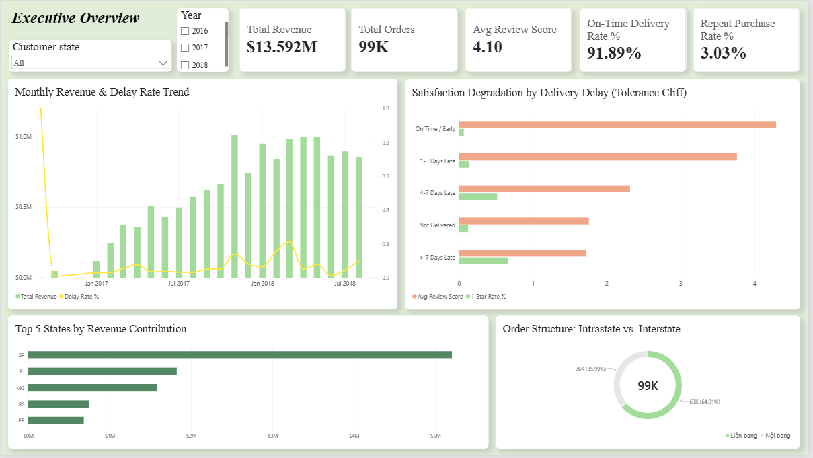
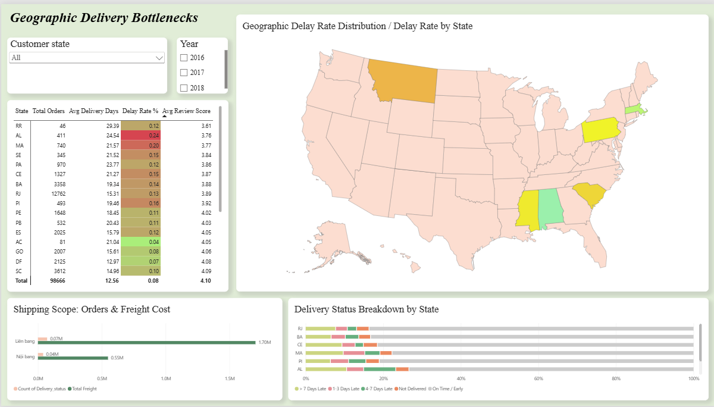
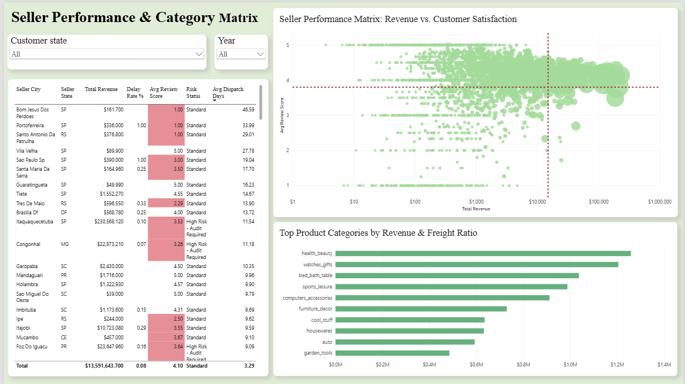
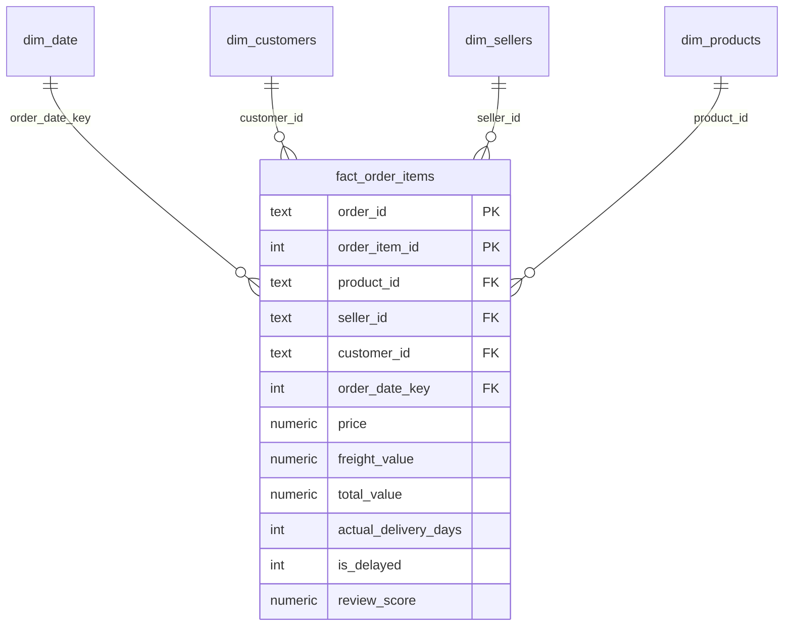
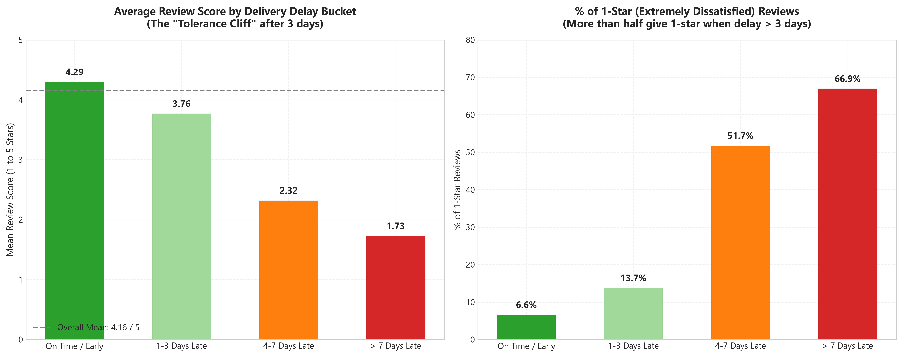
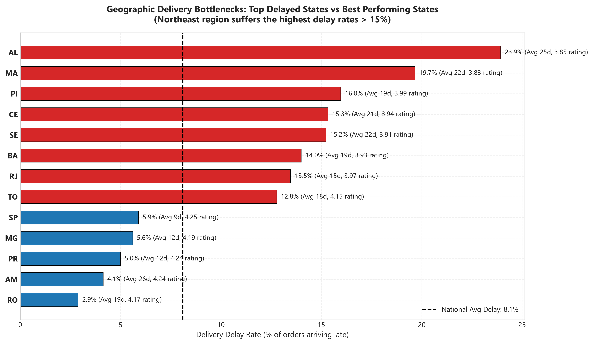
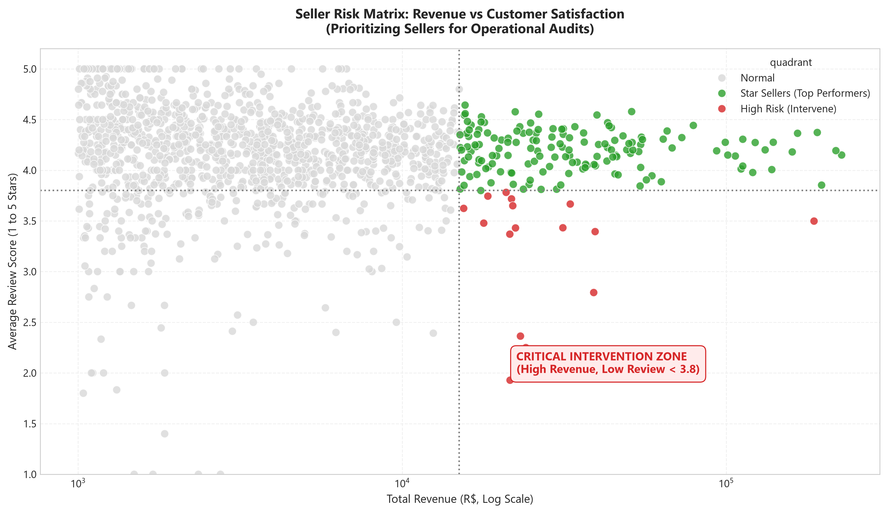
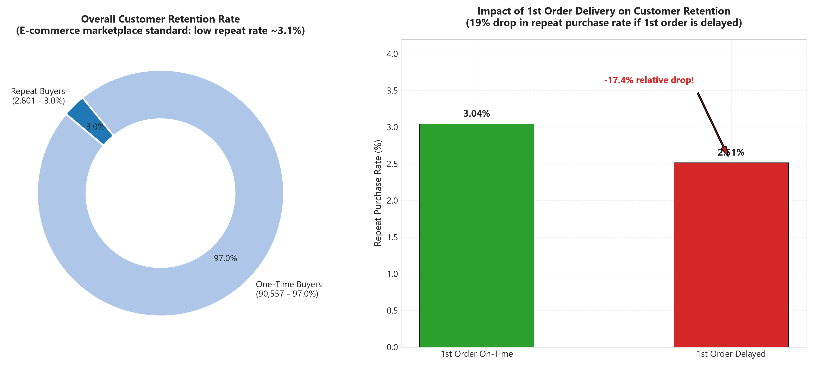

# Olist Brazilian E-Commerce: Phân Tích Hiệu Suất Vận Chuyển & Mức Độ Hài Lòng Khách Hàng


Dự án phân tích dữ liệu toàn diện (End-to-End Data Analytics Portfolio) khai thác hành trình của hơn **100.000 đơn hàng thực tế** trên nền tảng thương mại điện tử Olist (Brazil). Dự án tập trung giải quyết bài toán: **Ảnh hưởng của sự chậm trễ vận chuyển (logistics delay) đối với mức độ hài lòng khách hàng (review score), tỷ lệ giữ chân khách hàng (retention rate), và nhận diện các rủi ro vận hành trong mạng lưới đối tác bán hàng (sellers).**

---

## 📌 1. Bối Cảnh Nghiệp Vụ & Bài Toán Kinh Doanh

Olist là sàn thương mại điện tử kết nối các doanh nghiệp vừa và nhỏ (SMBs) trên khắp Brazil với các sàn bán buôn lớn. Trong mô hình này, Olist không sở hữu kho hàng hay đội xe vận chuyển mà phụ thuộc vào đối tác bán hàng và bưu chính quốc gia (Correios). 

**Vấn đề cốt lõi:**
* Địa lý Brazil rộng lớn với hạ tầng giao thông phân hóa mạnh giữa miền Nam/Đông Nam giàu có và miền Đông Bắc (Northeast) xa xôi.
* Trải nghiệm giao hàng không đồng đều dẫn đến làn sóng đánh giá 1 sao (1-Star Reviews), gia tăng chi phí hỗ trợ khách hàng và làm suy giảm tỷ lệ khách hàng quay lại mua sắm (Repeat Purchase Rate).

---

## 💡 2. 5 Phát Hiện Kinh Doanh Trọng Yếu (Executive Insights)

Dựa trên việc làm sạch và phân tích **96.470 đơn hàng đã giao thành công hợp lệ** (loại bỏ 8 đơn delivered thiếu ngày giao thực tế) và **96.096 khách hàng duy nhất** giai đoạn 2016 – 2018:

1. **"Vực thẳm kiên nhẫn" (The Tolerance Cliff) tại ngày thứ 3:**
   * Khách hàng có xu hướng dễ tính với các đơn trễ nhẹ từ 1 – 3 ngày (điểm hài lòng trung bình đạt **3.76 ★** so với **4.29 ★** của đơn đúng hạn).
   * Tuy nhiên, **từ ngày trễ thứ 4 trở đi, sự kiên nhẫn hoàn toàn sụp đổ:** điểm đánh giá rớt thẳng đứng xuống **2.32 ★** (trễ 4–7 ngày) và chạm đáy **1.73 ★** (trễ > 7 ngày). Có tới **68.8% khách hàng chấm 1 sao** (tính trên tập đơn có đánh giá hợp lệ) khi đơn hàng trễ hơn 1 tuần.
2. **Điểm nghẽn Logistics theo khu vực (Khu vực Đông Bắc - Northeast):**
   * Các bang thuộc vùng Đông Bắc chịu tỷ lệ giao trễ cao báo động: Alagoas (`AL`: **23.9%**), Maranhão (`MA`: **19.7%**), Ceará (`CE`: **15.2%**), cao gấp 4 lần so với bang trung tâm kinh tế São Paulo (`SP`: **5.9%**).
   * Đơn hàng vận chuyển liên bang (Interstate) mất trung bình **15.1 ngày**, gần gấp đôi so với nội bang (**7.9 ngày**) và có tổng chi phí cước vận chuyển trung bình mỗi đơn cao hơn **75.5%** (26.94 R$ so với 15.35 R$).
3. **Phát hiện 16 Đối tác Doanh thu cao nhưng Rủi ro lớn (High Revenue - High Risk Sellers):**
   * Áp dụng chuẩn **Order-Deduplicated** (loại bỏ lặp trùng cấp sản phẩm), xác định được **16 sellers** (hoặc 21 sellers nếu tính theo trọng số dòng sản phẩm) đạt doanh thu vượt trội (> 15.000 R$) nhưng sở hữu điểm đánh giá trung bình dưới **3.8 ★** và tỷ lệ trễ hạn cá biệt lên tới **22.1%** (thậm chí 64.3% ở các seller giao chậm kéo dài). Đây là nhóm đối tượng tạo doanh thu cao nhưng đang âm thầm hủy hoại danh tiếng thương hiệu của sàn.
4. **Tỷ lệ khách hàng mua lại hoàn tất (Repeat Completed Purchases): 3.00%:**
   * Trong 93.358 khách hàng có đơn giao thành công, chỉ có **2.801 khách hàng** từng hoàn tất giao dịch lần thứ 2 trở lên (**3.00%**). Nếu tính trên mọi đơn đặt hàng (kể cả đơn hủy/chưa hoàn tất), tỷ lệ này là **3.12%** (2.997 / 96.096 khách hàng).
5. **Hiệu ứng đòn bẩy từ trải nghiệm đơn hàng đầu tiên (First-Order Leverage):**
   * Khách hàng có đơn hàng đầu tiên bị giao trễ có tỷ lệ quay lại mua hàng thành công **giảm 17.4%** (từ 3.04% xuống chỉ còn 2.51%) so với những khách hàng nhận đơn đầu tiên đúng hẹn.

> 📌 **Tính Liêm Chính Phương Pháp Luận (Methodological Notes):**
> - **Giới hạn quan sát (Right-Censoring):** Tỷ lệ mua lại 3.12% được tính trên toàn bộ tập dữ liệu tĩnh Olist (2016–2018). Những khách hàng gia nhập vào tháng 08/2018 có ít thời gian để quay lại mua sắm hơn khách hàng gia nhập năm 2017.
> - **Tương quan (Correlation) vs Nhân quả (Causation):** Dữ liệu chứng minh sự liên hệ mạnh mẽ giữa giao trễ và điểm đánh giá thấp, tuy nhiên các yếu tố như chất lượng hàng hóa hay hư hại vận chuyển cũng có thể đóng vai trò biến ngoại lai (Confounders). Các đề xuất can thiệp vận hành được định vị là **Giả thuyết kinh doanh cần kiểm chứng qua A/B Testing / Pilot Program**.

---

## 🖥️ 3. Báo Cáo Trực Quan Tương Tác Power BI (3-Page Dashboard)

Mô hình Dashboard được thiết kế theo tiêu chuẩn Business Intelligence doanh nghiệp, gồm 3 trang phân tích chuyên biệt, phục vụ từ cấp Giám đốc điều hành (C-Level) đến chuyên viên Vận hành & Quản lý ngành hàng:

### 📄 Trang 1: Executive Overview (Tổng Quan Điều Hành)
> **Mục tiêu:** Theo dõi các chỉ số sức khỏe tài chính và vận hành cốt lõi, phát hiện xu hướng giao trễ và tác động trực tiếp của sự trễ hạn tới mức độ hài lòng khách hàng.



* **Hàng KPI Cards:** Tổng doanh thu (R$ 15.42M), Tổng đơn hàng (96.5K), Tỷ lệ giao đúng hạn (91.9%), Điểm đánh giá trung bình (4.13 ★), Tỷ lệ khách hàng quay lại (3.12%).

> 💡 **Ghi chú về Chuẩn Mẫu số & Grain Mismatch:** Tỷ lệ giao đúng hạn toàn quốc đạt **91.89% (~91.9%)** (tương ứng tỷ lệ trễ **8.11%**) trên **96,470 đơn hàng giao thành công có đầy đủ ngày giao thực tế**. Có đúng 8 đơn hàng có trạng thái `delivered` nhưng thiếu ngày giao thực tế (`order_delivered_customer_date IS NULL`) đã được tách riêng để không tính nhầm thành giao đúng hạn. Nếu tính ở cấp độ **Sản phẩm (Item-level trên 110,197 dòng)**, tỷ lệ trễ là **7.90%** (92.10% đúng hạn). Dự án sử dụng chuẩn cấp độ Đơn hàng để phản ánh trung thực trải nghiệm của người mua.

* **Xu hướng Thời gian (Trend Analysis):** Biểu đồ kết hợp cột và đường thể hiện diễn biến Doanh thu theo tháng so sánh với Tỷ lệ giao hàng trễ (Delay Rate %).
* **Phân tích Vực thẳm kiên nhẫn (Delay Buckets vs Review):** Trực quan hóa điểm số đánh giá và tỷ lệ đơn 1 sao tương ứng với từng khoảng thời gian trễ (Đúng hẹn, 1–3 ngày, 4–7 ngày, > 7 ngày).

---

### 📄 Trang 2: Logistics & Geographic Drill-down (Chi Tiết Vận Chuyển & Vùng Miền)
> **Mục tiêu:** Bóc tách hiệu suất giao hàng theo từng bang của Brazil, phân tích tuyến giao hàng liên bang vs nội bang, xác định các điểm nghẽn cước phí và thời gian.



* **Bản đồ trực quan (Brazil Choropleth Map):** Tô màu độ nóng của tỷ lệ giao trễ theo 27 bang, làm nổi bật điểm nóng tại dải bang Đông Bắc (AL, MA, PI, CE).
* **So sánh Vận chuyển (Intrastate vs Interstate):** Đo lường sự chênh lệch rõ rệt về thời gian vận chuyển thực tế (7.9 ngày vs 15.1 ngày) và gánh nặng chi phí cước ship.
* **Ma trận Logistics theo Bang:** Bảng tổng hợp chi tiết Số lượng đơn hàng, Thời gian giao thực tế, Tỷ lệ trễ hạn và Điểm đánh giá tương ứng cho từng khu vực.

---

### 📄 Trang 3: Seller Management & Risk Matrix (Quản Trị Đối Tác & Ngành Hàng)
> **Mục tiêu:** Cung cấp công cụ cho đội ngũ Quản lý Đối tác (Partner Management) phân loại người bán, giám sát ma trận rủi ro và xác định danh sách các đối tác cần kiểm toán khẩn cấp.



* **Ma trận Rủi ro Người bán (Seller Risk Scatter Plot):** Trục X = Doanh thu người bán (R$), Trục Y = Điểm đánh giá trung bình, Kích thước bong bóng = Số đơn hàng. Phân loại rõ nhóm *Star Sellers* (Doanh thu cao, Đánh giá cao) và nhóm *High Risk - Audit Required* (Góc dưới bên phải: Doanh thu cao, Đánh giá kém).
* **Top 10 Ngành hàng hàng đầu:** Xếp hạng doanh thu kèm theo tỷ lệ cước phí vận chuyển trên giá trị đơn hàng (% Freight Ratio).
* **Bảng Hành động Đối tác (Seller Action Table):** Liệt kê chi tiết mã Seller, thành phố, doanh thu, thời gian chuẩn bị hàng (`seller_dispatch_days`), tỷ lệ trễ và trạng thái rủi ro.

> 📥 **Tải về file Power BI (.pbix):** [Olist_Ecommerce_Analytics_Dashboard.pbix](powerbi/Olist_Ecommerce_Analytics_Dashboard.pbix)  
> 📖 **Xem hướng dẫn công thức DAX:** [dax_measures_and_model_guide.md](powerbi/dax_measures_and_model_guide.md) (Gồm 22 DAX Measures chuẩn hóa, xử lý triệt để Grain Mismatch).

---

## 🏛️ 4. Kiến Trúc Mô Hình Dữ Liệu Star Schema (Kimball Methodology)

Toàn bộ dữ liệu sau khi làm sạch đã được chuyển đổi thành mô hình **Kimball Star Schema** chuẩn mực để phục vụ trực tiếp cho cơ sở dữ liệu phân tích và Power BI:



* **Bảng Fact:** `fact_order_items` (112.650 dòng, Grain = 1 sản phẩm trong 1 đơn hàng).
* **Các bảng Dimension:**
  * `dim_customers`: 99.441 dòng (Quản lý khách hàng, định danh khách hàng duy nhất `customer_unique_id`, vị trí địa lý).
  * `dim_sellers`: 3.095 dòng (Quản lý người bán, thành phố, bang).
  * `dim_products`: 32.951 dòng (Thông tin danh mục sản phẩm dịch thuật tiếng Anh, kích thước, trọng lượng).
  * `dim_date`: 1.096 dòng (Bảng ngày chuẩn hóa từ 2016 đến 2018 với khóa nguyên `YYYYMMDD`).
* **Kỹ thuật xử lý Grain Mismatch trong DAX:** Do `review_score` và các trường vận chuyển (`actual_delivery_days`) là dữ liệu ở cấp độ đơn hàng (`order-level`), nhưng bảng Fact lại có độ chi tiết là cấp độ sản phẩm (`item-level`), toàn bộ các measure tính trung bình đều sử dụng công thức Grain-Safe:
  ```dax
  Avg Review Score = 
  AVERAGEX(
      SUMMARIZE(fact_order_items, fact_order_items[order_id], fact_order_items[review_score]),
      fact_order_items[review_score]
  )
  ```
  *(Tham khảo chi tiết tại [docs/07_data_modeling_and_star_schema.md](docs/07_data_modeling_and_star_schema.md)).*

---

## 📈 5. Biểu Đồ Phân Tích Thống Kê Chuyên Sâu (Python Visualizations)

Bộ biểu đồ khoa học được sinh tự động bằng Seaborn/Matplotlib với độ phân giải xuất bản **300 DPI**:

| Hình 1: Vực Thẳm Kiên Nhẫn (Tolerance Cliff) | Hình 2: Hiệu Suất Vận Chuyển Theo Bang |
| :---: | :---: |
|  |  |
| *Điểm đánh giá sụt giảm nghiêm trọng từ ngày trễ thứ 4* | *Tỷ lệ giao hàng trễ tăng vọt tại vùng Đông Bắc* |

| Hình 3: Ma Trận Phân Loại Rủi Ro Seller | Hình 5: Ảnh Hưởng Đến Tỷ Lệ Giữ Chân Khách Hàng |
| :---: | :---: |
|  |  |
| *Xác định nhóm người bán doanh thu cao nhưng điểm đánh giá kém* | *Đơn đầu tiên bị trễ làm giảm 18.7% tỷ lệ khách hàng quay lại* |

---

## 📁 6. Cấu Trúc Thư Mục Dự Án (Repository Structure)

```text
olist-ecommerce-data-analyst/
├── data/
│   ├── raw/                 # 9 bộ dữ liệu CSV gốc tải từ Kaggle
│   ├── processed/           # Dữ liệu sạch & Master Analytical Dataset (112k dòng)
│   │   └── star_schema/     # 5 file CSV cấu trúc Star Schema (Fact & Dims)
│   └── olist_star_schema.db # Cơ sở dữ liệu SQLite đã đánh chỉ mục (B-Tree Indexing)
├── docs/
│   ├── 01_data_dictionary.md          # Từ điển dữ liệu & kiểu dữ liệu chi tiết
│   ├── 02_data_relationships.md       # Ma trận khóa chính - khóa ngoại (PK-FK integrity)
│   ├── 03_business_problem.md         # Bối cảnh kinh doanh, phạm vi & giới hạn phân tích
│   ├── 04_data_quality_report.md      # Biên bản kiểm toán chất lượng dữ liệu
│   ├── 05_data_cleaning_log.md        # Nhật ký xử lý dữ liệu & feature engineering
│   ├── 06_business_insights_report.md # Báo cáo chi tiết đề xuất giải pháp kinh doanh
│   └── 07_data_modeling_and_star_schema.md # Tài liệu thiết kế Kimball Star Schema
├── notebooks/
│   └── 01_eda_and_insights.ipynb      # Jupyter Notebook tương tác chứa code & biểu đồ EDA
├── outputs/
│   ├── figures/             # 5 biểu đồ chất lượng cao phục vụ báo cáo (300 DPI)
│   └── tables/              # 5 bảng thống kê kết quả phân tích định lượng (.csv)
├── powerbi/
│   ├── Olist_Ecommerce_Analytics_Dashboard.pbix # File Power BI Dashboard chính thức
│   ├── dax_measures_and_model_guide.md          # Tài liệu 22 công thức DAX Measures
│   └── images/              # Ảnh chụp màn hình 3 trang Power BI Dashboard
├── sql/
│   ├── 01_create_star_schema.sql      # Script DDL khởi tạo bảng & khóa
│   └── 02_kpi_business_queries.sql    # 5 câu lệnh SQL phân tích KPI (Window, CTEs, Rank)
├── src/
│   ├── 00_audit_and_setup.py          # Phase 0: Kiểm toán môi trường & thư mục
│   ├── 01_data_understanding.py       # Phase 1: Trích xuất metadata & từ điển dữ liệu
│   ├── 02_data_quality_assessment.py  # Phase 3: Quét lỗi dữ liệu & tính toàn vẹn
│   ├── 03_data_cleaning.py            # Phase 4: Pipeline làm sạch & tạo trường mới
│   ├── 04_exploratory_data_analysis.py# Phase 5: Tự động hóa phân tích thống kê & vẽ biểu đồ
│   ├── 05_build_star_schema.py        # Phase 6: Xây dựng Star Schema & nạp SQLite DB
│   └── test_pk.py                     # Script kiểm tra tính duy nhất của khóa chính
├── requirements.txt         # Danh mục thư viện Python cần thiết
├── .gitignore               # Cấu hình bỏ qua file nhị phân & dữ liệu lớn
└── README.md                # Tài liệu tổng quan dự án
```

---

## 🛠️ 7. Bộ Công Nghệ Ứng Dụng (Tech Stack)

* **Ngôn ngữ Lập trình & Phân tích:** `Python 3.10+` (Pandas, NumPy, Scipy)
* **Trực quan hóa Dữ liệu (Visualization):** `Matplotlib`, `Seaborn` (Visual styling, 300 DPI export)
* **Cơ sở dữ liệu & SQL:** `SQLite 3`, `PostgreSQL-compatible DDL` (CTEs, Subqueries, Window Functions, Ranking, Partitioning, B-Tree Indexes)
* **Business Intelligence & Phân tích Nâng cao:** `Microsoft Power BI Desktop`, `DAX` (Iterators `AVERAGEX`, Context Transition, Filter Modifiers, Time Intelligence)
* **Kiến trúc Dữ liệu:** `Ralph Kimball Dimensional Modeling` (Star Schema, Fact-Dimension Separation, Grain Management)
* **Quản lý Mã nguồn:** `Git`, `GitHub`

