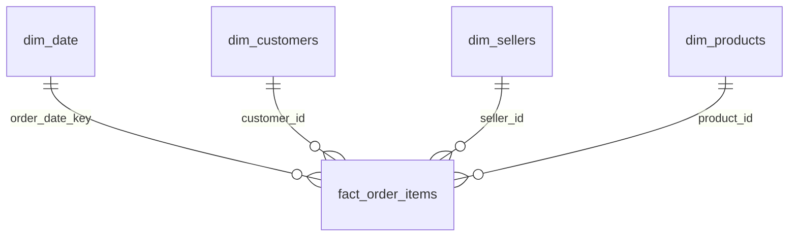

# Olist Brazilian E-Commerce: Phân Tích Hiệu Suất Vận Chuyển & Mức Độ Hài Lòng Khách Hàng


Dự án phân tích dữ liệu toàn diện (End-to-End Data Analytics Project) khai thác hành trình của gần **100.000 đơn hàng thực tế** (99,441 đơn hàng, 112,650 dòng sản phẩm) trên nền tảng thương mại điện tử Olist (Brazil). Dự án tập trung giải quyết bài toán: **Ảnh hưởng của sự chậm trễ vận chuyển (logistics delay) đối với mức độ hài lòng khách hàng (review score), tỷ lệ giữ chân khách hàng (retention rate), và nhận diện các rủi ro vận hành trong mạng lưới đối tác bán hàng (sellers).**

---

## 📌 1. Bối Cảnh Nghiệp Vụ & Bài Toán Kinh Doanh

Olist là sàn thương mại điện tử kết nối các doanh nghiệp vừa và nhỏ (SMBs) trên khắp Brazil. Trong mô hình này, Olist không sở hữu kho hàng hay đội xe vận chuyển mà phụ thuộc vào đối tác bán hàng và bưu chính quốc gia (Correios). 

**Vấn đề cốt lõi:**
* Địa lý Brazil rộng lớn với hạ tầng giao thông phân hóa mạnh giữa miền Nam/Đông Nam giàu có và miền Đông Bắc (Northeast) xa xôi.
* Trải nghiệm giao hàng không đồng đều dẫn đến làn sóng đánh giá 1 sao, gia tăng chi phí hỗ trợ khách hàng và làm suy giảm tỷ lệ khách hàng quay lại mua sắm.

---

## 💡 2. 5 Phát Hiện Kinh Doanh Trọng Yếu (Executive Insights)

Dựa trên việc làm sạch và phân tích **96,470 đơn hàng đã giao thành công hợp lệ** (loại bỏ các đơn thiếu ngày giao thực tế hoặc ngày dự kiến) và **93,350 khách hàng duy nhất có đơn giao thành công** giai đoạn 2016 – 2018:

1. **"Vực thẳm kiên nhẫn" (The Tolerance Cliff) tại ngày thứ 3:**
   * Khách hàng có xu hướng dễ tính với các đơn trễ nhẹ từ 1 – 3 ngày (điểm hài lòng trung bình đạt **3.29 ★** so với **4.29 ★** của đơn đúng hạn).
   * Tuy nhiên, **từ ngày trễ thứ 4 trở đi, sự kiên nhẫn hoàn toàn sụp đổ:** điểm đánh giá rớt thẳng đứng xuống **2.10 ★** (trễ 4–7 ngày) và chạm đáy **1.70 ★** (trễ > 7 ngày). Có tới **69.83% khách hàng chấm 1 sao** (tính trên tập đơn có đánh giá hợp lệ) khi đơn hàng trễ hơn 1 tuần.
2. **Điểm nghẽn Logistics theo khu vực (Khu vực Đông Bắc):**
   * Các bang thuộc vùng Đông Bắc chịu tỷ lệ giao trễ cao báo động: Alagoas (`AL`: **21.41%**), Maranhão (`MA`: **17.43%**), Sergipe (`SE`: **15.22%**), cao gấp 3–5 lần so với bang trung tâm kinh tế São Paulo (`SP`: **4.49%**).
   * Đơn hàng vận chuyển liên bang (Interstate) mất trung bình **15.1 ngày**, gần gấp đôi so với nội bang (**7.9 ngày**) và có tổng chi phí cước vận chuyển trung bình mỗi đơn cao hơn **75.5%** (26.94 R$ so với 15.35 R$).
3. **Phát hiện 16 Đối tác Doanh thu cao nhưng Rủi ro lớn (High Revenue - High Risk Sellers):**
   * Áp dụng chuẩn **Order-Deduplicated** (loại bỏ lặp trùng cấp sản phẩm), xác định được **16 sellers** đạt doanh thu vượt trội (> 15,000 R$) nhưng sở hữu điểm đánh giá trung bình dưới **3.8 ★**.
   * Nhóm này bao gồm 11 seller đủ cỡ mẫu (≥ 30 đơn) có tỷ lệ trễ bình quân trọng số là **9.00%** và thời gian chuẩn bị hàng (`seller_dispatch_days`) bình quân lên tới **7.0 ngày** (cá biệt có seller mất tới 11.9 ngày), cùng 5 seller cần theo dõi do cỡ mẫu nhỏ.
4. **Tỷ lệ khách hàng mua lại hoàn tất (Repeat Completed Purchases): 3.00%:**
   * Trong 93,350 khách hàng có đơn giao thành công hợp lệ, có **2,801 khách hàng** từng hoàn tất giao dịch lần thứ 2 trở lên (**3.00%**). 
5. **Hiệu ứng đòn bẩy từ trải nghiệm đơn đầu tiên giao thành công (First Delivered Order Leverage):**
   * Khách hàng có đơn hàng đầu tiên *giao thành công* bị trễ có tỷ lệ quay lại mua hàng thành công **giảm 17.1%** (từ 3.04% xuống chỉ còn 2.52%, kiểm định Chi-Square $p < 0.05$) so với những khách hàng nhận đơn đầu tiên đúng hẹn.

> 📌 **Tính Liêm Chính Phương Pháp Luận (Methodological Notes):**
> - **Giới hạn quan sát (Right-Censoring):** Tỷ lệ mua lại 3.00% được tính trên toàn bộ tập dữ liệu tĩnh Olist (2016–2018). Những khách hàng gia nhập vào cuối giai đoạn có ít thời gian để quay lại mua sắm hơn.
> - **Tương quan (Correlation) vs Nhân quả (Causation):** Dữ liệu chứng minh sự liên hệ mạnh mẽ giữa giao trễ và điểm đánh giá thấp. Các đề xuất can thiệp vận hành được định vị là **Giả thuyết kinh doanh cần kiểm chứng qua A/B Testing**.

---

## 🖥️ 3. Báo Cáo Trực Quan Tương Tác Power BI (3-Page Dashboard)

Mô hình Dashboard được thiết kế theo tiêu chuẩn Business Intelligence doanh nghiệp, gồm 3 trang phân tích chuyên biệt:

### 📄 Trang 1: Executive Overview (Tổng Quan Điều Hành)
> **Mục tiêu:** Theo dõi các chỉ số sức khỏe tài chính và vận hành cốt lõi, phát hiện xu hướng giao trễ và tác động trực tiếp của sự trễ hạn tới mức độ hài lòng khách hàng.


* **Hàng KPI Cards:**
  * **Tổng doanh thu giao dịch (Gross Order Value):** R$ 15.42M / **Delivered Product Revenue:** R$ 13.22M.
  * **Tổng đơn hàng:** 96.5K (96,470 đơn giao thành công hợp lệ).
  * **Tỷ lệ giao đúng hạn (On-Time Delivery Rate):** 93.2% (tương ứng 6.77% trễ ở cấp Order-level).
  * **Điểm đánh giá trung bình:** 4.16 ★ (trên đơn delivered hợp lệ).
  * **Tỷ lệ khách hàng quay lại:** 3.00% (2,801 / 93,350 khách hàng có đơn delivered).

> 💡 **Ghi chú về Chuẩn Mẫu số & Grain Mismatch:** Tỷ lệ giao đúng hạn toàn quốc đạt **93.23%** trên **96,470 đơn hàng giao thành công có đầy đủ ngày giao thực tế và ngày dự kiến**. Pipeline sử dụng cờ `is_valid_delivery_delay` để loại bỏ các đơn thiếu dữ liệu, tránh tính nhầm thành giao đúng hạn.

---

### 📄 Trang 2: Geographic Delivery Bottlenecks (Điểm Nghẽn Vận Chuyển Theo Địa Lý)
> **Mục tiêu:** Bóc tách hiệu suất giao hàng theo từng bang của Brazil, phân tích tuyến giao hàng liên bang vs nội bang.


* **Bản đồ trực quan (Brazil Choropleth Map):** Trực quan hóa tỷ lệ giao trễ theo các bang, làm nổi bật điểm nóng tại dải bang Đông Bắc (AL 21.4%, MA 17.4%, SE 15.2%). 
* **So sánh Vận chuyển (Intrastate vs Interstate):** Đo lường sự chênh lệch rõ rệt về thời gian vận chuyển thực tế (7.9 ngày vs 15.1 ngày) và gánh nặng chi phí cước ship (15.35 R$ vs 26.94 R$).

---

### 📄 Trang 3: Seller Performance & Category Matrix (Hiệu Suất Đối Tác & Ngành Hàng)
> **Mục tiêu:** Phân loại đối tác người bán, giám sát ma trận rủi ro và xác định danh sách các đối tác cần kiểm toán khẩn cấp.


* **Ma trận Rủi ro Người bán (Seller Risk Scatter Plot):** Trục X = Doanh thu người bán (R$), Trục Y = Điểm đánh giá trung bình. Phân loại rõ nhóm *Star Sellers* và nhóm *High Risk - Audit Required* (Góc dưới bên phải: Doanh thu cao, Đánh giá kém < 3.8 ★).
* **Top Ngành hàng hàng đầu:** Dẫn đầu doanh thu: `Health Beauty` (R$ 1.23M), `Watches Gifts` (R$ 1.17M), `Bed Bath Table` (R$ 1.02M).
* **Bảng Hành động Đối tác (Seller Action Table):** Liệt kê chi tiết mã Seller, thành phố, doanh thu, thời gian chuẩn bị hàng, tỷ lệ trễ và trạng thái rủi ro.

---

## 🏛️ 4. Kiến Trúc Mô Hình Dữ Liệu Star Schema (Kimball Methodology)

Toàn bộ dữ liệu sau khi làm sạch đã được chuyển đổi thành mô hình **Kimball Star Schema** chuẩn mực:



* **Bảng Fact:** `fact_order_items` (112,650 dòng, Grain = 1 sản phẩm trong 1 đơn hàng).
* **Các bảng Dimension:** `dim_customers` (99,441 dòng), `dim_sellers` (3,095 dòng), `dim_products` (32,951 dòng), `dim_date` (1,096 dòng).
* **Kỹ thuật xử lý Grain Mismatch trong DAX:** Do `review_score` là dữ liệu ở cấp độ đơn hàng (`order-level`), nhưng bảng Fact lại có độ chi tiết là cấp độ sản phẩm (`item-level`), toàn bộ các measure tính trung bình đều sử dụng công thức Grain-Safe:
  ```dax
  Avg Review Score Delivered = 
  AVERAGEX(
      FILTER(
          SUMMARIZE(
              fact_order_items, 
              fact_order_items[order_id], 
              fact_order_items[order_status],
              fact_order_items[is_valid_delivery_delay],
              fact_order_items[review_score]
          ),
          fact_order_items[order_status] = "delivered" && 
          fact_order_items[is_valid_delivery_delay] = 1 &&
          NOT(ISBLANK(fact_order_items[review_score]))
      ),
      fact_order_items[review_score]
  )
  ```

---

## 📈 5. Biểu Đồ Phân Tích Thống Kê Chuyên Sâu (Python Visualizations)

Bộ biểu đồ khoa học được sinh tự động bằng Seaborn/Matplotlib với độ phân giải xuất bản **300 DPI**:

| Hình 1: Vực Thẳm Kiên Nhẫn (Tolerance Cliff) | Hình 2: Hiệu Suất Vận Chuyển Theo Bang |
| :---: | :---: |
|  |  |
| *Điểm đánh giá sụt giảm nghiêm trọng từ ngày trễ thứ 4* | *Tỷ lệ giao hàng trễ tăng vọt tại vùng Đông Bắc* |

| Hình 3: Ma Trận Phân Loại Rủi Ro Seller | Hình 4: Hiệu Suất Danh Mục Sản Phẩm |
| :---: | :---: |
|  |  |
| *Xác định nhóm người bán doanh thu cao nhưng điểm đánh giá kém* | *Xếp hạng doanh thu và tỷ trọng cước phí vận chuyển theo ngành hàng* |

| Hình 5: Ảnh Hưởng Đến Tỷ Lệ Giữ Chân Khách Hàng |
| :---: |
|  |
| *Đơn đầu tiên giao thành công bị trễ làm giảm 17.1% tỷ lệ khách hàng quay lại* |

---

## 📁 6. Cấu Trúc Thư Mục Dự Án (Repository Structure)

```text
olist-ecommerce-data-analyst/
├── data/
│   ├── raw/                 # 9 bộ dữ liệu CSV gốc tải từ Kaggle (được .gitignore)
│   ├── processed/           # Dữ liệu sạch & Master Analytical Dataset (112k dòng)
│   │   └── star_schema/     # 5 file CSV cấu trúc Star Schema (Fact & Dims)
│   └── olist_star_schema.db # Cơ sở dữ liệu SQLite đã đánh 7 B-Tree Indexes
├── docs/
│   ├── 01_data_dictionary.md          # Từ điển dữ liệu & kiểu dữ liệu chi tiết
│   ├── 02_data_relationships.md       # Ma trận khóa chính - khóa ngoại (PK-FK integrity)
│   ├── 03_business_problem.md         # Bối cảnh kinh doanh, phạm vi & mục tiêu phân tích
│   ├── 04_data_quality_report.md      # Biên bản kiểm toán chất lượng dữ liệu
│   ├── 05_data_cleaning_log.md        # Nhật ký xử lý dữ liệu & feature engineering
│   ├── 06_business_insights_report.md # Báo cáo chi tiết đề xuất giải pháp kinh doanh
│   └── 07_data_modeling_and_star_schema.md # Tài liệu thiết kế Kimball Star Schema & DAX
├── notebooks/
│   └── 01_eda_and_insights.ipynb      # Jupyter Notebook tương tác chứa code & biểu đồ EDA
├── outputs/
│   ├── figures/             # 5 biểu đồ chất lượng cao phục vụ báo cáo (300 DPI)
│   └── tables/              # 5 bảng thống kê kết quả phân tích định lượng (.csv)
├── powerbi/
│   ├── dax_measures_and_model_guide.md # Hướng dẫn công thức DAX Measures & mô hình
│   └── images/              # Ảnh chụp màn hình 3 trang Power BI Dashboard
├── sql/
│   ├── 01_create_star_schema.sql      # Script DDL khởi tạo 5 bảng & 7 Performance Indexes
│   └── 02_kpi_business_queries.sql    # 5 câu lệnh SQL phân tích KPI (Window, CTEs, Rank)
├── src/
│   ├── 00_audit_and_setup.py          # Phase 0: Kiểm toán môi trường & thư mục
│   ├── 01_data_understanding.py       # Phase 1: Trích xuất metadata & từ điển dữ liệu
│   ├── 02_data_quality_assessment.py  # Phase 3: Quét lỗi dữ liệu & tính toàn vẹn
│   ├── 03_data_cleaning.py            # Phase 4: Pipeline làm sạch & Feature Engineering
│   ├── 04_exploratory_data_analysis.py# Phase 5: Tự động hóa phân tích thống kê & vẽ biểu đồ
│   ├── 05_build_star_schema.py        # Phase 6: Xây dựng Star Schema & nạp SQLite DB
│   └── test_pk.py                     # Script kiểm tra tính toàn vẹn khóa chính
├── requirements.txt         # Danh mục thư viện Python cần thiết
├── .gitignore               # Cấu hình bỏ qua file nhị phân & dữ liệu lớn
└── README.md                # Tài liệu tổng quan dự án
```

---

## 🚀 7. Hướng Dẫn Chạy Dự Án (Getting Started)

### Bước 1: Tải Dữ Liệu Gốc từ Kaggle
Dữ liệu gốc không được đưa vào repository (`.gitignore`). Bạn cần tải từ Kaggle:
1. Truy cập [Brazilian E-Commerce Public Dataset by Olist](https://www.kaggle.com/datasets/olistbr/brazilian-ecommerce).
2. Tải xuống và giải nén 9 file CSV vào thư mục `data/raw/`.

### Bước 2: Cài Đặt Môi Trường
```bash
# Tạo môi trường ảo Python
python -m venv .venv

# Kích hoạt (Windows)
.venv\Scripts\activate

# Cài đặt thư viện
pip install -r requirements.txt
```

### Bước 3: Chạy Pipeline Từ Đầu Đến Cuối
```bash
python src/00_audit_and_setup.py          # Kiểm toán môi trường & thư mục
python src/01_data_understanding.py       # Trích xuất metadata & từ điển dữ liệu
python src/02_data_quality_assessment.py  # Quét lỗi dữ liệu & tính toàn vẹn
python src/03_data_cleaning.py            # Làm sạch & Feature Engineering
python src/04_exploratory_data_analysis.py# Phân tích thống kê & Vẽ biểu đồ
python src/05_build_star_schema.py        # Xây dựng Star Schema & nạp SQLite DB
```

---

## 🛠️ 8. Bộ Công Nghệ Ứng Dụng (Tech Stack)

* **Ngôn ngữ Lập trình & Phân tích:** `Python 3.10+` (Pandas, NumPy, Scipy)
* **Trực quan hóa Dữ liệu (Visualization):** `Matplotlib`, `Seaborn` (Visual styling, 300 DPI export)
* **Cơ sở dữ liệu & SQL:** `SQLite 3`, `PostgreSQL-compatible DDL` (CTEs, Subqueries, Window Functions, Ranking, Partitioning, B-Tree Indexes)
* **Business Intelligence & Phân tích Nâng cao:** `Microsoft Power BI Desktop`, `DAX` (Iterators `AVERAGEX`, Context Transition, Filter Modifiers, Time Intelligence)
* **Kiến trúc Dữ liệu:** `Ralph Kimball Dimensional Modeling` (Star Schema, Fact-Dimension Separation, Grain Management)
* **Kiểm định Thống kê:** `Scipy.stats` (Chi-Square Test of Independence)
* **Quản lý Mã nguồn:** `Git`, `GitHub`
```
