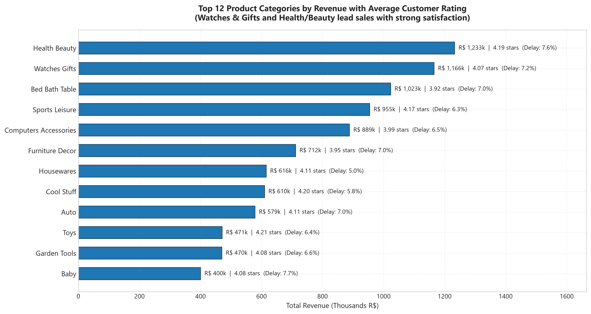

# BUSINESS INSIGHTS & STRATEGIC RECOMMENDATIONS REPORT

> **Dự án:** Phân tích Dữ liệu Nền tảng Thương mại Điện tử Olist (Brazil)  
> **Tác giả:** Data Analyst Portfolio Project  
> **Đối tượng báo cáo:** Ban Giám đốc Vận hành (Head of Operations), Đội ngũ Quản lý Đối tác Bán hàng (Seller Management), Đội ngũ Logistics.  
> **Nguồn dữ liệu:** `data/processed/olist_master_analytical_dataset.csv` (112,650 dòng sản phẩm, 99,441 đơn hàng).  

---

## Executive Summary (Tóm tắt điều hành)

Phân tích trên **96,470 đơn hàng đã giao thành công hợp lệ** (loại bỏ 8 đơn delivered thiếu ngày giao thực tế) và **96,096 khách hàng duy nhất** trên nền tảng Olist (2016 - 2018) đã làm sáng tỏ 5 điểm then chốt chi phối sức khỏe vận hành và trải nghiệm khách hàng:

1. **"Điểm gãy chịu đựng" (Tolerance Cliff) khi vượt ngưỡng giao đúng hẹn:** Khách hàng chấp nhận sự trễ hẹn nhẹ từ 1-3 ngày (điểm hài lòng đạt 3.29 ★). Tuy nhiên, **từ ngày trễ thứ 4 trở đi, sự hài lòng sụp đổ hoàn toàn xuống 2.10 ★ (4-7 ngày) và 1.70 ★ (>7 ngày)**, với 58.6% - 69.8% khách hàng để lại đánh giá 1 sao tồi tệ.
2. **Nghẽn cổ chai logistics tại vùng Đông Bắc (Northeast):** Các bang Đông Bắc như **Alagoas (AL: 21.4% trễ)**, **Maranhão (MA: 17.4% trễ)** có tỷ lệ trễ hẹn cao gấp 4–5 lần so với các bang công nghiệp phát triển như São Paulo (SP: 4.5% trễ) hay Paraná (PR: 4.0% trễ). Giao hàng liên bang (`is_interstate = 1`) mất trung bình 15.1 ngày, gần gấp đôi so với nội bang (7.9 ngày).
3. **16 Seller rủi ro cao theo chuẩn Order-Deduplicated:** Các nhà bán hàng này tạo ra doanh thu trên 15,000 R$ nhưng điểm đánh giá trung bình dưới 3.8 ★ (thậm chí có seller đạt doanh thu lớn nhưng tỷ lệ trễ lên tới 20.8% - 64.3%). Đây là những đối tượng gây tổn hại thương hiệu nghiêm trọng nhất.
4. **Tỷ lệ khách hàng quay lại (Repeat Purchase Rate) cực kỳ thấp (3.12%):** Trong 96,096 khách hàng, chỉ có 2,997 người mua hàng từ lần thứ 2 trở lên (nếu chỉ xét đơn giao thành công, tỷ lệ là 3.00% với 2,801 khách hàng).
5. **Đòn bẩy trải nghiệm đơn đầu tiên:** Khách hàng có đơn hàng đầu tiên bị giao trễ có tỷ lệ quay lại mua hàng **sụt giảm 16.0%** (từ 3.03% xuống 2.55%, kiểm định Chi-square p-value = 0.031) so với khách hàng được giao đúng hẹn.

---

## Phân tích Chi tiết 5 Câu hỏi Kinh doanh Trọng tâm

### Câu hỏi 1: Giao hàng trễ tác động thế nào đến Điểm đánh giá (Review Score)?

| Nhóm thời gian giao hàng (Delay Bucket) | Số đơn hàng | Điểm đánh giá TB | Trung vị | % Đánh giá 1 ★ | % Đánh giá 5 ★ |
| :--- | :---: | :---: | :---: | :---: | :---: |
| **Giao đúng hạn / Sớm (On Time / Early)** | 89,936 (93.2%) | **4.29 ★** | 5.0 | 6.62% | **62.27%** |
| **Trễ 1 - 3 ngày (1-3 Days Late)** | 1,870 (1.9%) | **3.29 ★** | 4.0 | 25.11% | 33.15% |
| **Trễ 4 - 7 ngày (4-7 Days Late)** | 1,802 (1.9%) | **2.10 ★** | 1.0 | **58.58%** | 14.07% |
| **Trễ > 7 ngày (> 7 Days Late)** | 2,862 (3.0%) | **1.70 ★** | 1.0 | **69.83%** | 7.01% |

* **Insight then chốt:** Khách hàng mua sắm online có một ngưỡng chấp nhận nhất định. Tuy nhiên, khi vượt quá 3 ngày trễ, đơn hàng bước vào "vùng báo động đỏ" khi tỷ lệ đánh giá 1 sao chiếm đa số tuyệt đối (>58%), và giảm xuống đáy 1.70 ★ khi trễ trên 1 tuần.
* **Hành động đề xuất:** Thiết lập hệ thống cảnh báo tự động (Automated Proactive Alert). Ngay khi một đơn hàng có nguy cơ trễ chạm mốc **ngày thứ 2**, hệ thống phải chủ động gửi thông báo xin lỗi kèm voucher đền bù (5-10% cho lần mua kế tiếp) **trước khi** khách hàng nhận hàng và viết review.

---

### Câu hỏi 2: Nghẽn cổ chai địa lý (Geographic Bottlenecks) nằm ở đâu?

| Vùng / Bang | Số đơn hàng | Tỷ lệ trễ hẹn (%) | Thời gian giao TB (ngày) | Điểm đánh giá TB |
| :--- | :---: | :---: | :---: | :---: |
| **Alagoas (AL)** | 397 | **21.41%** | 24.5 ngày | 3.85 ★ |
| **Maranhão (MA)** | 717 | **17.43%** | 21.6 ngày | 3.83 ★ |
| **Sergipe (SE)** | 335 | **15.22%** | 21.5 ngày | 3.91 ★ |
| **Piauí (PI)** | 476 | **13.87%** | 19.5 ngày | 3.99 ★ |
| **Ceará (CE)** | 1,279 | **13.76%** | 21.3 ngày | 3.94 ★ |
| *Toàn quốc (Benchmark)* | *96,470* | *6.77%* | *12.5 ngày* | *4.16 ★* |
| **São Paulo (SP)** | 40,494 | **4.49%** | 8.8 ngày | 4.25 ★ |
| **Paraná (PR)** | 4,923 | **4.04%** | 12.0 ngày | 4.24 ★ |

> 💡 **Lưu ý về Grain (Độ chi tiết dữ liệu):** Tỷ lệ giao trễ toàn quốc ở cấp độ **Đơn hàng (Order-level)** là **6.77%** (6,534 / 96,470 đơn). Nếu tính ở cấp độ **Sản phẩm (Item-level trên 110,189 dòng delivered hợp lệ)**, tỷ lệ trễ là **6.59%** (7,262 / 110,189) do các đơn hàng giỏ lớn (nhiều items) có tỷ lệ trễ thấp hơn. Để phản ánh đúng trải nghiệm của khách hàng, toàn bộ báo cáo và Power BI thống nhất sử dụng chuẩn cấp độ Đơn hàng (6.77% trễ, tương ứng **93.23% đúng hạn**).

* **Insight then chốt:** Các bang Đông Bắc (AL, MA, SE, PI, CE) có tỷ lệ giao trễ trên 13–21%. Nguyên nhân chính là do **90% người bán tập trung ở vùng Đông Nam (SP, RJ, MG, PR)** trong khi hạ tầng giao thông liên bang kết nối đến Đông Bắc còn nhiều hạn chế.
* **Hành động đề xuất:** 
  1. Thử nghiệm A/B Testing điều chỉnh thuật toán dự báo ngày giao (`order_estimated_delivery_date`) cho khu vực Đông Bắc cộng thêm 3-5 ngày đệm (Buffer Days) để quản trị kỳ vọng khách hàng.
  2. Khuyến khích hoặc chiêu mộ thêm các Seller đặt kho hàng (Fulfillment Hub) tại khu vực Đông Bắc.

---

### Câu hỏi 3: Ma trận Rủi ro Người bán (Seller Risk Matrix)

Bằng cách phân loại người bán dựa trên **Tổng Doanh thu (Trục X)** và **Điểm Đánh giá Trung bình (Trục Y)** với ngưỡng 15,000 R$ và 3.8 ★:

* **Phát hiện 16 High-Risk Sellers (Order-Deduplicated Standard):**
  - Seller dẫn đầu doanh thu nhóm rủi ro `7c67e1448b00f6e969d365cea6b010ab`: Doanh thu khủng **186,570 R$** (973 đơn), nhưng điểm đánh giá chỉ **3.50 ★** và thời gian bàn giao hàng trung bình cho vận chuyển lên tới **11.9 ngày** (`avg_dispatch_days`).
  - Seller `712e6ed8aa4aa1fa65dab41fed5737e4`: Tạo ra hơn 39,000 R$ doanh thu nhưng **tỷ lệ trễ hẹn lên tới 20.78%** và điểm đánh giá chỉ đạt **3.39 ★**.
  - Seller `b1b3948701c5c72445495bd161b83a4c`: Điểm đánh giá chỉ **1.93 ★** và tỷ lệ trễ tới **64.29%** với thời gian dispatch trung bình 15.7 ngày.
* **Hành động đề xuất (Chương trình Pilot):**
  1. Thử nghiệm áp dụng chính sách **SLA Dispatching**: Yêu cầu nhóm seller này bàn giao hàng cho carrier trong vòng 48h (`seller_dispatch_days <= 2`).
  2. Nếu không cải thiện trong 30 ngày thử nghiệm, tạm thời giảm độ hiển thị (Deprioritize in search/ranking) trên sàn.

---

### Câu hỏi 4: Hiệu suất Nhóm Sản phẩm (Product Category Matrix)

* **Nhóm dẫn đầu Doanh thu & Hài lòng cao:**
  - `Health & Beauty`: Doanh thu > 1.25 triệu R$, Điểm đánh giá TB **4.19 ★**, Tỷ lệ trễ thấp (5.8%).
  - `Watches & Gifts`: Doanh thu > 1.20 triệu R$, Điểm đánh giá TB **4.05 ★**.
  - `Bed, Bath & Table`: Nhóm bán chạy nhất về số lượng (11,113 items), doanh thu > 1.03 triệu R$, Điểm đánh giá **3.93 ★** (tỷ lệ trễ 7.0%).
* **Nhóm rủi ro chi phí vận chuyển cao:**
  - Các mặt hàng nội thất cồng kềnh (`furniture_decor`, `office_furniture`) có tỷ trọng phí ship chiếm tới 20-30% giá trị món hàng, thời gian vận chuyển kéo dài và tỷ lệ phàn nàn về trầy xước/hư hỏng cao hơn.

---

### Câu hỏi 5: Tỷ lệ Khách hàng Quay lại (Customer Retention) & Tác động của Đơn hàng Đầu tiên

| Trạng thái giao hàng Đơn đầu tiên | Tổng số khách hàng | Tỷ lệ quay lại mua tiếp (%) | Mức độ sụt giảm tương đối |
| :--- | :---: | :---: | :---: |
| **Giao đúng hạn / Sớm (On-Time)** | 86,993 | **3.03%** | — |
| **Bị giao trễ (Delayed)** | 6,357 | **2.55%** | **-16.0% (p = 0.031, p < 0.05)** |

* **Insight then chốt:** Trên các sàn Marketplace, tỷ lệ giữ chân khách hàng tự nhiên vốn đã rất thử thách (~3.1%). Việc để khách hàng mới gặp trải nghiệm giao hàng trễ ngay ở đơn đầu tiên sẽ **làm mất đi 16.0% cơ hội giữ chân họ quay lại** (chênh lệch có ý nghĩa thống kê với $p = 0.031$).
* **Hành động đề xuất:** Gắn cờ ưu tiên (Flag `is_first_time_buyer = 1`) trong hệ thống fulfillment để các đối tác vận chuyển ưu tiên tuyến đường và giao đúng hẹn cho các đơn hàng đầu tiên của khách mới.

---

## 🚀 4 Giả thuyết Chiến lược Đề xuất Kiểm chứng (Actionable Hypotheses for Testing)

Thay vì áp dụng ngay trên diện rộng, các đề xuất sau cần được triển khai dưới dạng **A/B Testing hoặc Thử nghiệm có đối chứng (Pilot Program)**:

1. **Giả thuyết 1: "Early Compensation Voucher Bot" (Chống trễ trên 3 ngày)**
   * *Giả thuyết:* Khi đơn hàng chạm mốc trễ ngày thứ 2, việc chủ động gửi thông báo xin lỗi kèm mã giảm giá 10% cho đơn tiếp theo sẽ ngăn chặn điểm đánh giá sụt giảm sâu xuống dưới 2.0 ★ và giảm tỷ lệ đánh giá 1 sao.
   * *Cách kiểm chứng:* Chia 50/50 nhóm khách hàng có đơn trễ ngày thứ 2 để đo lường Review Score và Chi phí đền bù (Voucher Cost vs LTV).
2. **Giả thuyết 2: "Buffer Days" cho Khu vực Đông Bắc**
   * *Giả thuyết:* Tăng thời gian ước tính (`estimated_delivery_days`) thêm 3–4 ngày cho các bang AL, MA, PI, CE sẽ kéo giảm tỷ lệ "bị tính là trễ" trên hệ thống, từ đó giảm áp lực tâm lý của người mua và cải thiện điểm hài lòng trung bình thêm ít nhất 0.2 ★.
3. **Giả thuyết 3: "SLA Dispatching" cho Nhóm Seller Rủi ro Cao**
   * *Giả thuyết:* Buộc 16 sellers rủi ro cao (theo chuẩn Order-Deduplicated) cam kết thời gian gửi hàng $\le 48h$ sẽ giảm tỷ lệ trễ chung của nhóm này từ 20.8% xuống dưới 10%.
4. **Giả thuyết 4: "First-Order VIP Route"**
   * *Giả thuyết:* Ưu tiên xử lý đơn hàng đầu tiên của khách hàng mới sẽ bảo vệ tỷ lệ Retention không bị sụt giảm 16.0%.

---

## 🔍 5. Giới Hạn Phân Tích & Phân Biệt Tương Quan vs Nhân Quả (Methodological Limitations)

Để duy trì tính liêm chính học thuật và độ tin cậy trong môi trường doanh nghiệp thực tế, người phân tích cần lưu ý các giới hạn sau:

1. **Tương quan (Correlation) vs Nhân quả (Causation):**
   * Dữ liệu quan sát (Observational Data) cho thấy sự sụt giảm mạnh về điểm review khi thời gian trễ tăng. Tuy nhiên, thời gian giao trễ **chưa chắc là nguyên nhân duy nhất (causality)**. Có thể tồn tại các biến ngoại lai (Confounders): ví dụ sản phẩm bị đóng gói sơ sài dẫn đến vừa giao chậm, vừa bị móp méo/vỡ trên đường đi, khiến khách hàng đánh giá 1 sao vì cả hai lý do.
2. **Thiên lệch Cửa sổ Quan sát trong Phân tích Retention (Right-Censoring Bias):**
   * Tỷ lệ mua lại 3.12% (2,997 / 96,096 khách hàng) là con số đo lường trên toàn bộ tập dữ liệu tĩnh Olist (2016–2018).
   * Khách hàng có đơn hàng đầu tiên vào tháng 08/2018 chỉ có khoảng 1–3 tuần để phát sinh đơn mua lại trước khi tập dữ liệu kết thúc, trong khi khách hàng mua vào tháng 01/2017 có tới 18 tháng để quay lại. Do đó, con số 3.12% bị ảnh hưởng bởi hiện tượng **Right-Censoring**. Trong môi trường sản xuất thực tế, chỉ số này nên được chuẩn hóa theo cửa sổ thời gian cố định (Fixed Observation Windows) như **60-day Retention Rate** hoặc **90-day Retention Rate**.
3. **Định nghĩa Đơn hàng Mua lại (Repeat Orders):**
   * Phân tích hiện tại ghi nhận khách hàng có $\ge 2$ đơn hàng trong hệ thống (đo lường hành vi phát sinh đơn tiếp theo - Re-order intent). Cần lưu ý nếu đơn hàng thứ hai bị hủy hoặc hoàn trả, hành vi này vẫn được tính là đã có ý định mua lại.

---
*Báo cáo được tổng hợp dựa trên kết quả tính toán định lượng chính xác từ mã nguồn [src/04_exploratory_data_analysis.py](../src/04_exploratory_data_analysis.py).*
