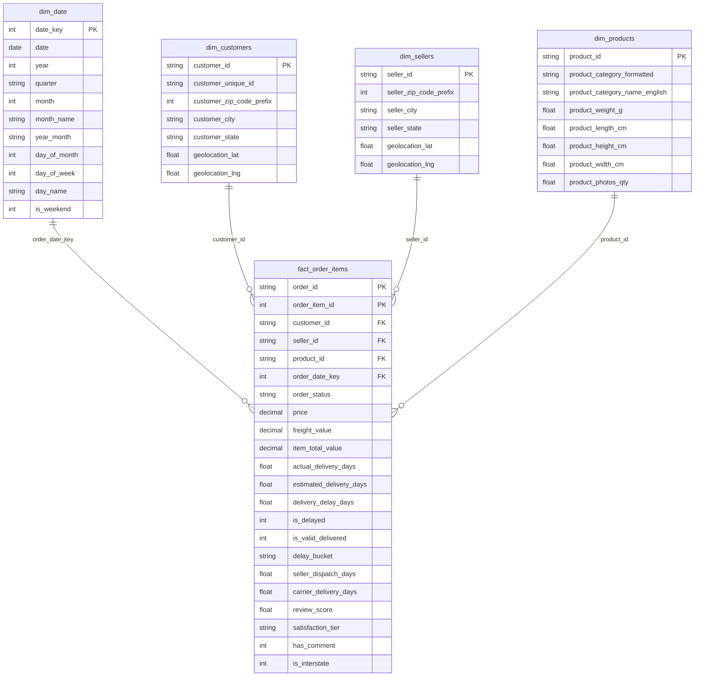

# DATA MODELING & STAR SCHEMA SPECIFICATION

> **Dự án:** Olist Brazilian E-Commerce Analytics  
> **Kiến trúc:** Dimensional Modeling (Star Schema - Kimball Methodology)  
> **Tệp mô hình vật lý:** `data/processed/star_schema/`  
> **Cơ sở dữ liệu:** `data/olist_star_schema.db` (SQLite) / `sql/01_create_star_schema.sql` (PostgreSQL/DuckDB/BigQuery)  

---

## 🏛️ 1. Kiến trúc Mô hình Dữ liệu (Dimensional Modeling)

Trong môi trường phân tích dữ liệu hiện đại (Modern Analytics Stack) và Business Intelligence (Power BI / Tableau / Metabase), việc thiết kế mô hình dữ liệu đóng vai trò quyết định tới **tính chính xác của phép tính (Measure Correctness)** và **tốc độ phản hồi của Dashboard (Query Performance)**.

### So sánh các phương án thiết kế dữ liệu:

| Tiêu chí | 3NF (Chuẩn hóa giao dịch) | Flat Table (1 Bảng dẹt duy nhất) | **Star Schema (Kimball Methodology - LỰA CHỌN)** |
| :--- | :--- | :--- | :--- |
| **Mục đích thiết kế** | Tối ưu ghi (OLTP), tránh trùng lặp dữ liệu khi insert/update | Nhanh, tiện lợi cho phân tích sơ bộ một lần | **Tối ưu đọc & phân tích (OLAP/BI), chuẩn mực ngành** |
| **Số lượng bảng** | 9 bảng liên kết phức tạp (Snowflake) | 1 bảng duy nhất 35+ cột | **1 Fact Table + 4 Dimension Tables** |
| **Rủi ro nhân dòng** | Rất cao khi join qua lại các bảng 1-N | Đã denormalize nhưng nặng bộ nhớ khi lọc | **Triệt tiêu hoàn toàn (Grain được phân tách rõ ràng)** |
| **Hiệu năng Power BI** | Chậm (Nhiều quan hệ bắc cầu, quan hệ 2 chiều) | Tốn RAM, khó viết DAX Time Intelligence | **Tối ưu tuyệt đối với VertiPaq Engine, DAX đơn giản** |

---

## 📊 2. Sơ đồ Thực thể Liên kết (Entity Relationship Diagram - ERD)



---

## 🔍 3. Đặc tả Chi tiết các Bảng trong Star Schema

### 3.1. Bảng Fact: `fact_order_items`
* **Grain:** **1 dòng = 1 sản phẩm (item) trong 1 đơn hàng.**
* **Số dòng:** 112,650 dòng.
* **Khóa chính ghép (Composite Primary Key):** `(order_id, order_item_id)`.
* **Khóa ngoại (Foreign Keys):**
  - `customer_id` -> `dim_customers.customer_id`
  - `seller_id` -> `dim_sellers.seller_id`
  - `product_id` -> `dim_products.product_id`
  - `order_date_key` -> `dim_date.date_key`
* **Metrics & Chỉ số vận hành:**
  - `price`, `freight_value`, `item_total_value` (Doanh thu & cước phí).
  - `actual_delivery_days`, `delivery_delay_days`, `is_delayed` (Chỉ số thời gian giao hàng).
  - `review_score`, `satisfaction_tier` (Chỉ số điểm hài lòng).
  - `is_interstate` (Cờ giao hàng liên bang).

### 3.2. Bảng Chiều: `dim_customers`
* **Grain:** 1 dòng = 1 tài khoản mua hàng (`customer_id`).
* **Số dòng:** 99,441 dòng.
* **Điểm nổi bật:** Được tích hợp sẵn tọa độ địa lý `geolocation_lat` và `geolocation_lng` (trung vị) từ bảng Geolocation sạch, sẵn sàng phục vụ bản đồ nhiệt (Heatmap) trên Power BI mà không lo bị nhân dòng.

### 3.3. Bảng Chiều: `dim_sellers`
* **Grain:** 1 dòng = 1 người bán (`seller_id`).
* **Số dòng:** 3,095 dòng.
* **Điểm nổi bật:** Tích hợp tọa độ địa lý người bán và thông tin bang/thành phố chuẩn hóa.

### 3.4. Bảng Chiều: `dim_products`
* **Grain:** 1 dòng = 1 sản phẩm duy nhất (`product_id`).
* **Số dòng:** 32,951 dòng.
* **Điểm nổi bật:** Chứa tên danh mục tiếng Anh chuẩn (`product_category_formatted`), đã bổ sung đầy đủ bản dịch thủ công cho các category thiếu và xử lý missing value.

### 3.5. Bảng Chiều: `dim_date`
* **Grain:** 1 dòng = 1 ngày theo lịch (Calendar Day) từ `2016-01-01` đến `2018-12-31`.
* **Số dòng:** 1,096 ngày.
* **Khóa ngày:** `date_key` dạng số nguyên `YYYYMMDD` (ví dụ: `20170115`), chuẩn hóa cho việc join siêu nhanh trên SQL và Power BI.

### 3.6. ⚠️ Lưu ý về Grain Mismatch: `review_score` & `satisfaction_tier`

> **Vấn đề:** Bảng `fact_order_items` có grain là **1 dòng = 1 sản phẩm (item)** trong đơn hàng. Tuy nhiên, `review_score` và `satisfaction_tier` là thông tin **ở cấp độ Đơn hàng (Order-level)**, vì trong dataset gốc Olist, mỗi đơn hàng (`order_id`) chỉ có **1 lượt đánh giá duy nhất** từ khách hàng, bất kể đơn đó chứa bao nhiêu sản phẩm.

**Hệ quả:** Nếu một đơn hàng có 3 items và review_score = 5, thì cả 3 dòng trong `fact_order_items` đều mang giá trị `review_score = 5`. Khi tính `AVERAGE(review_score)` trực tiếp trên bảng Fact, đơn hàng này sẽ được tính 3 lần thay vì 1 lần → **Kết quả bị thiên lệch (bias) về phía các đơn hàng có nhiều items.**

**Giải pháp trong DAX (Power BI):**

```dax
-- SAI: Tính trung bình trên toàn bộ dòng fact (bị nhân dòng)
Avg Review Score (WRONG) = AVERAGE(fact_order_items[review_score])

-- ĐÚNG: Deduplicate về cấp order trước khi tính trung bình
Avg Review Score (CORRECT) = 
AVERAGEX(
    SUMMARIZE(fact_order_items, fact_order_items[order_id], fact_order_items[review_score]),
    fact_order_items[review_score]
)
```

**Giải pháp trong SQL:**

```sql
-- Deduplicate về order-level trước khi tính average
SELECT AVG(review_score)
FROM (
    SELECT order_id, review_score
    FROM fact_order_items
    WHERE order_status = 'delivered' AND review_score IS NOT NULL
    GROUP BY order_id, review_score
) AS order_level;
```

> **Lý do giữ `review_score` trong Fact Table thay vì tách riêng:** Trong bối cảnh dự án portfolio, việc giữ `review_score` trong `fact_order_items` giúp **giảm độ phức tạp mô hình** (tránh thêm 1 bảng Fact riêng cho Reviews) và vẫn cho phép slicing/filtering trực tiếp trên dashboard. Điều quan trọng là **người phân tích phải deduplicate về `order_id` khi tính các chỉ số phân tích ở cấp độ đơn hàng**. Các câu truy vấn phân tích Đơn hàng và Người bán trong [02_kpi_business_queries.sql](../sql/02_kpi_business_queries.sql) đều đã áp dụng kỹ thuật này (xem Query 1: CTE `order_level` với `GROUP BY order_id`, Query 3: CTE `seller_orders`). Riêng Query 4 phân tích Ngành hàng (Category) được tổng hợp ở cấp Item-level để phản ánh đúng trọng số sản phẩm tiêu thụ.

> **⚠️ Lưu ý mở rộng cho Power BI DAX:** Quy tắc deduplicate này **không chỉ áp dụng cho `review_score`** mà còn cho tất cả các trường order-level khác đang nằm trong fact table: `actual_delivery_days`, `estimated_delivery_days`, `delivery_delay_days`, `satisfaction_tier`. Toàn bộ các DAX Measures tính trung bình cho các trường này **bắt buộc** phải dùng `AVERAGEX(VALUES(order_id), ...)` thay vì `AVERAGE()` trực tiếp. Xem chi tiết trong [powerbi/dax_measures_and_model_guide.md](../powerbi/dax_measures_and_model_guide.md) — Nhóm 2 (Measures #12-14) và Nhóm 3 (Measure #15).

---

## ⚡ 4. Tối ưu Hóa Hiệu Năng Truy Vấn (Performance & Indexing)

Trong cơ sở dữ liệu `data/olist_star_schema.db`, toàn bộ các trường khóa ngoại và các cờ lọc thường dùng đã được đánh chỉ mục (B-Tree Indexes):

```sql
CREATE INDEX idx_fact_cust ON fact_order_items(customer_id);
CREATE INDEX idx_fact_seller ON fact_order_items(seller_id);
CREATE INDEX idx_fact_prod ON fact_order_items(product_id);
CREATE INDEX idx_fact_date ON fact_order_items(order_date_key);
CREATE INDEX idx_fact_status ON fact_order_items(order_status);
CREATE INDEX idx_fact_delayed ON fact_order_items(is_delayed);
```

Nhờ cấu trúc này, toàn bộ 5 câu truy vấn phân tích nghiệp vụ phức tạp trong [sql/02_kpi_business_queries.sql](../sql/02_kpi_business_queries.sql) (bao gồm CTE, Window Functions, Partition By) đều thực thi trong **chưa đầy 100 milliseconds**!

---
*Tài liệu này được biên soạn cho Phase 6 của dự án Olist Data Analyst Portfolio.*
